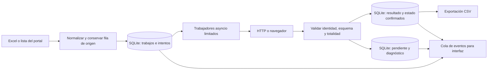

# Guía para replicar extracción concurrente, reanudable y verificable

Versión: 2026-10-11. Estado: implementado en AstraCode para Conocimientos,
DUAs por manifiesto, Movimientos y Detalles, con diferencias descritas aquí.
Este documento conserva las decisiones y los pasos necesarios para adaptar
otro bot sin depender del historial de conversación.

Se conserva una copia idéntica en `Manifiestos_Bot2/docs/GUIA_REPLICACION_BOTS.md`
y `Detalles_BOT/docs/GUIA_REPLICACION_BOTS.md`. Al actualizarla, sincronizar ambas
copias. Los documentos específicos de cada repositorio contienen la evidencia
detallada; esta guía describe el patrón común y sus excepciones.

## 1. Objetivo y contrato que debe conservarse

Reducir navegación repetida y permitir varias consultas simultáneas, sin cambiar
el contenido de la extracción ni perder trabajos al detener o reiniciar.
SQLite conserva resultados y progreso; el CSV se genera desde esos resultados.

Antes de modificar otro bot, fijar su contrato: columnas y orden, valores y ceros
iniciales, duplicados legítimos, filtros, identidad de cada consulta, orden de
exportación, tratamiento de tablas vacías y criterio de fin de paginación.
Guardar ejemplos del extractor original para comparar todas las celdas.
Conservar la pantalla de progreso existente al incorporar nuevos procedimientos.

No confundir filas de entrada, consultas únicas y filas de datos descargadas.
Un manifiesto puede producir cero, una o miles de filas. Un DUA repetido en el
Excel puede representar una sola consulta con varias referencias de origen.
La política de duplicados se define antes de importar; nunca se deduplican datos
extraídos solo para acelerar.

## 2. Elegir el método por el comportamiento del portal

| Condición observada | Método | Aplicación actual |
| --- | --- | --- |
| Un enlace devuelve el grid completo o páginas verificables usando la sesión actual | HTTP asíncrono con cookies de Playwright; sesión ASP.NET independiente para tablas | Conocimientos, DUAs por manifiesto, Movimientos |
| La consulta necesita formulario, eventos JavaScript y CAPTCHA | Navegador; contexto aislado por trabajador | Detalles |
| El HTML del detalle ya contiene todos los valores y sus scripts son secundarios | Aligerar solo el detalle después de comparar todos los valores | Detalles, combinado con reutilización |
| Los datos se generan por JavaScript o hacen falta pasos intermedios | Mantener la navegación necesaria y medir alternativas | Evaluar por procedimiento; no copiar la simplificación a ciegas |

Inspeccionar respuestas de documento y AJAX, URL, método, formulario, cookies,
estado GeneXus (`GXState`), errores y fin de tabla. Una petición del portal puede
ser POST AJAX aunque no navegue. Un grid oculto puede ser más completo que las
filas visibles; comprobarlo contra la salida original.

Conservar las cookies y tokens que validan los enlaces. No reconstruir enlaces
ni reutilizar tokens de otra consulta sin comprobar el protocolo. Conocimientos
comparte el contexto HTTP de la lista. Desde 2026-10-10, DUAs y Movimientos crean
un `APIRequestContext` independiente por manifiesto: conservan GX, acceso y el
User-Agent del navegador y excluyen únicamente `ASP.NET_SessionId`. El cliente
se conserva durante todas las páginas de ese manifiesto y se libera al terminar
o detener. Las pruebas con DUAs aéreo septiembre demostraron que una consulta
lenta bloqueaba las rápidas al compartir sesión ASP.NET; aislarla dejó avanzar
las rápidas. No aplicar esta exclusión de cookies a otro portal sin verificar
sus enlaces, identidad y estado de paginación.

## 3. Arquitectura común



Aunque la configuración diga «hilos», las descargas concurrentes son tareas
`asyncio`: mientras una espera la red, otras avanzan. No son 32 navegadores
independientes ni 32 escritores de CSV. Tk tiene su hilo principal y recibe
eventos; no se actualizan widgets desde los trabajadores.

La escritura SQLite se serializa. Manifiestos usa una conexión en el bucle de
procesamiento; Detalles usa `JobStore`, `RLock` y transacciones `BEGIN IMMEDIATE`.
Los bloqueos `OutputLock` / `RunLock` impiden dos procesos activos sobre el mismo
lote. Mantener transacciones breves y nunca esperar la red dentro de ellas.
No se implantó un servidor de base de datos ni se exige WAL para este patrón.

Separar responsabilidades: selección/importación, protocolo de consulta,
extractor de datos, cola persistente, exportador, interfaz y diagnósticos.
Así se puede cambiar la navegación sin reescribir columnas ni estados.

## 4. Modelo persistente y contabilidad sin saltos

La información mínima de un trabajo es: identidad estable, orden de selección,
fila(s) de origen, estado, intentos, último error y resultado confirmado.
Para tablas paginadas, añadir páginas parciales con offset y marca de final.
Mantener la identidad del lote y sus filtros para no mezclar períodos o modos.

| Estado conceptual | Manifiestos | Detalles |
| --- | --- | --- |
| Por intentar | `Pendiente` | `pending` |
| Reservado por un trabajador | `Descargando` | `running` |
| Falló y puede reintentarse | `Pendiente`, con error e intento | `retry` |
| Resultado validado y confirmado | `Guardado` | `succeeded` |
| Entrada incorrecta | Revisión de selección según procedimiento | `invalid`, con fila original |

La reserva debe ser atómica y solo admitir pendientes. Confirmar el resultado
y el éxito en **la misma transacción**. Un intento tiene identificador propio:
un trabajador atrasado no debe confirmar una reserva que ya se resolvió.
Detalles limita cada DUA a una oportunidad por ronda; Manifiestos arma la cola
de pendientes al comenzar el intento. No usar el mayor índice del CSV ni un TXT
de «procesados» para decidir qué falta: terminar la fila 200 no prueba que la 12
esté guardada.

En una ejecución que termina normalmente, sin entradas inválidas:

```text
seleccionados = guardados + pendientes + en_curso
al finalizar: en_curso = 0
intentados_en_esta_ejecución = pendientes_al_iniciar
```

Si hay inválidos, contarlos explícitamente en el total y conservar su origen.
«Intentado» incluye éxito y fallo; «completado» exige resultados válidos para
todos los trabajos válidos. Por ejemplo, 357 seleccionados pueden terminar con
330 guardados y 27 pendientes: se intentaron los 357, pero el lote sigue pendiente.
Al detener manualmente no se promete que todos hayan sido intentados: deben
quedar contabilizados y recuperables los no iniciados y los interrumpidos.

Al reiniciar, adquirir primero el bloqueo del lote; solo entonces recuperar
reservas interrumpidas. Consultar únicamente pendientes/retry, conservando los
éxitos. No resetear trabajos que pertenezcan a otra instancia activa.
Un fallo de disco no es un fallo de red: debe detener o reportar la persistencia,
sin declarar guardado un dato que no llegó a SQLite.

## 5. Estrategia HTTP y checkpoints de páginas

1. Abrir el formulario principal con Playwright y confirmar sus filtros.
2. Capturar una lista estable de enlaces e identidades de la respuesta confirmada.
   En TICA el `GXState` del DOM puede conservar datos anteriores después de AJAX;
   se usan los metadatos confirmados, no un valor comprimido desactualizado.
3. Persistir la selección con su orden. Crear una cola solo con pendientes.
4. Descargar mediante `context.request.get/post`, compartiendo las cookies
   válidas del contexto. Limitar la cantidad de trabajadores.
5. Validar HTTP, identidad, columnas, cantidad y estado final. Una tabla vacía
   solo es éxito si la respuesta acredita que está vacía y completa.
6. Guardar cada página validada antes de pedir la siguiente. En EOF, confirmar
   el manifiesto completo y eliminar sus checkpoints en la misma transacción.
7. Liberar cada `APIResponse` en `finally` con `dispose()`.

Conocimientos valida offsets contiguos y secuencias sin repeticiones, sigue NEXT
hasta EOF y exporta según su secuencia. DUAs y Movimientos conservaron el orden
de filas del portal y sus duplicados legítimos; las respuestas examinadas tenían
el grid completo en una sola página. No imponerles la regla de secuencia de
Conocimientos si su contenido no tiene ese contrato.

Para refrescar sin perder avance, Conocimientos conserva las páginas en SQLite,
obtiene un formulario nuevo y verifica que coincidan la primera página y la
última página guardada usada como ancla. Continúa desde el siguiente offset.
Puede volver a leer páginas de comprobación, pero no vuelve a descargar todo el
prefijo guardado. Si cambian filas, tamaño de página u offsets, conserva el
checkpoint y deja pendiente para revisión; no mezcla dos versiones de la tabla.

El refresco predeterminado es cada 600 segundos entre páginas. En Conocimientos
y Movimientos, un timeout afecta a una operación; no hay límite total por
manifiesto por defecto (`timeout_total=0`).
Así un manifiesto grande puede tardar más de 30 minutos sin descartarse por su
duración total. Los reintentos HTTP transitorios son acotados, con espera; una
identidad equivocada o página faltante no se acepta como error transitorio inocuo.
Una respuesta única interrumpida no permite guardar «media tabla»: se reintenta
solo ese manifiesto, mientras los demás confirmados se conservan.

Excepción solicitada para DUAs (2026-10-10): sus descargas HTTP usan `timeout=0`
y el flujo fuerza el límite total a cero, aunque exista `duas_timeout_total`.
Una consulta lenta permanece activa hasta recibir respuesta o pulsar Detener,
mientras los otros trabajadores continúan. Cada página hace un solo intento:
un estado HTTP distinto de 200 o un contenido inválido deja el trabajo pendiente
y el trabajador toma el siguiente; no hay reintentos internos multiplicados.
HTTP 200 sigue exigiendo identidad, esquema y cantidad completos, incluidos los
vacíos válidos. Cada 15 segundos se informa la espera en el registro y en
«Actividad / último error», con SQLite y la cola Tk habituales. El formulario
principal conserva sus límites de navegación. Los límites externos de las
pruebas reales solo acotan el diagnóstico y no son límites de producción.
Evidencia y reproducción: `docs/DUAS_SESIONES_Y_ESPERA_20261010.md` en Manifiestos.
La lectura del HTML de DUAs/Movimientos usa `asyncio.to_thread`; la cola y SQLite
siguen en su hilo original. Prueba real: dos tablas rápidas guardadas mientras
la lenta esperaba. La lenta quedó pendiente por contenido inválido (incluida
una pantalla `frmAmbiente` con HTTP 200); no se confirmó su descarga completa.

Actualización posterior solicitada: en DUAs, el formulario `frmAmbiente` con
`aspxerrorpath=/Tica/hcgduama.aspx` y sin GXState válido se clasifica como
`Excluido`, no como Pendiente. La exclusión y su intento quedan en SQLite y no
se vuelven a consultar al reanudar. No aplicar esa exclusión a errores HTTP
genéricos, a tablas inconsistentes ni a otros procedimientos. La suma de
seleccionados al finalizar ahora es guardados + pendientes + excluidos. Las
bases anteriores amplían el CHECK de jobs mediante una transacción; se conserva
su selección, datos, intentos e historial bajo el mismo bloqueo de salida.

Los errores `invalid literal for int() with base 10` de DUAs son reintentables.
Al iniciar se recuperan antiguas exclusiones de conversión sin datos guardados
ni indicio frmAmbiente, marcándolas Pendiente y auditando job_reconsiderations.
Las exclusiones frmAmbiente y los guardados se conservan. Un contador de grid
con asteriscos se acepta como desbordado solo si la cantidad alcanza el ancho
de su máscara y otro contador numérico coincide con DataV; de lo contrario
sigue Pendiente. No convertir celdas ni identificadores para corregir contadores.
En DUAs, `datos=61356, grid=61356, nRC=-4180` corresponde exactamente a una
representación de 16 bits con signo. Se acepta nRC desbordado únicamente con Count
numérico igual a DataV y nRC igual a `(filas + 32768) % 65536 - 32768`, manteniendo
las demás verificaciones. Se probó el guardado/exportación íntegros de 61.356 filas,
los límites de 16 bits y las vueltas posteriores; otros valores siguen pendientes.

## 6. Estrategia de navegador reutilizado por trabajador

Cada trabajador de Detalles posee su contexto y página, procesa sus trabajos
secuencialmente y no comparte campos ni CAPTCHA con otro trabajador.
Antes de cada DUA vuelve al formulario y obtiene/verifica su CAPTCHA actual.
Reutilizar sesión ahorra inicialización y navegación secundaria; no significa
reutilizar valores anteriores del formulario.

El contexto se cierra después de un fallo, al finalizar o cancelar, y entre
consultas al alcanzar 100 usos o 600 segundos de antigüedad. Los umbrales están
en el motor actual, no expuestos como preferencias. El cierre entre consultas
evita interrumpir un resultado válido por un temporizador. Las rondas posteriores
a la primera limitan la concurrencia a dos y esperan antes de recuperar pendientes.

Para otro bot, preservar este ciclo:

```text
reservar trabajo -> crear/reutilizar contexto propio -> abrir formulario fresco
-> completar y verificar -> consultar -> validar resultado -> confirmar SQLite
error -> registrar pendiente -> descartar contexto
cancelación -> devolver reserva a pendiente -> cerrar recursos
```

## 7. Rellenado seguro y detalle ligero

Completar por IDs/selectores únicos, sin depender del foco ni del tabulador.
Detalles usa el setter nativo de los inputs y conserva eventos input/change/blur.
Verifica aduana, año, consecutivo y CAPTCHA antes del clic y en el POST real.
El control debe cubrir AJAX y navegación, reconocer la URL sin sensibilidad a
mayúsculas y rechazar valores vacíos, alterados o duplicados. Si cambia el origen
de la imagen CAPTCHA entre su resolución y el envío, se rechaza ese intento.
El resultado también debe corresponder al DUA reservado antes de confirmarlo.
El catálogo CAPTCHA existente es específico de TICA; no es una solución universal
para otros portales ni debe copiarse suponiendo que sus imágenes son iguales.

La simplificación de Detalles intercepta únicamente GET de navegación a
`hcimdpola.aspx`, descarga la respuesta con la sesión del navegador y valida el
HTML original. Solo si contiene el detalle válido retira scripts y recursos
secundarios de la representación y compara **los 38 valores** antes y después.
La extracción final usa el HTML original, no la representación reducida.
Las rutas se desinstalan y las respuestas se liberan en `finally`.

Advertencias, HTTP inesperado, identidad distinta, diferencias entre valores o
`SALIR=OK` conservan la respuesta original para el manejo normal del motor.
Los casos de clic adicional siguen pendientes: no se automatizaron. No retirar
JavaScript del formulario ni de una página cuyo contenido dependa de él.
Una URL con mayúsculas distintas puede impedir que una ruta se aplique: registrar
si realmente se activó la estrategia, no deducirlo de la opción habilitada.

## 8. Configuración y uso actuales

| Bot | Configuración | Concurrencia | Recuperación |
| --- | --- | --- | --- |
| Conocimientos | `config/config.json`: `conocimientos_concurrencia`, `conocimientos_refresco_segundos`, `conocimientos_timeout_total` | GUI/CLI 1–32; predeterminado 32 | Checkpoints de páginas; reintento de pendientes |
| DUAs por manifiesto | `duas_concurrencia`; opciones con prefijo `duas_` | GUI/CLI 1–32; predeterminado 4 | Misma cola; grid completo validado |
| Movimientos | `movimientos_concurrencia`; opciones con prefijo `movimientos_` | GUI/CLI 1–32; predeterminado 4 | Misma cola; grid completo validado |
| Detalles | `config/machine.json`: `cant_hilos`, `timeout`, `max_retries` | GUI 1–20; predeterminado 1; preferencia local conservada en 7 | Rondas, máximo 2 trabajadores al reintentar |

En Detalles, `reuse_context` y `lightweight_details` son booleanos JSON,
predeterminados `true`. No tienen controles propios en la GUI. Cerrar la app
antes de editar esas claves; conservar el resto del archivo.

| `reuse_context` | `lightweight_details` | Estrategia |
| --- | --- | --- |
| `false` | `false` | Contexto nuevo y navegación original |
| `true` | `false` | Reutilización solamente |
| `false` | `true` | Detalle ligero solamente |
| `true` | `true` | Combinación aplicada |

`max_retries` representa el número total de rondas, incluida la primera.
`timeout` es por operación del navegador. No se elevó Detalles a 32 en la GUI:
32 tareas funcionando en una simulación no demuestran 32 consultas reales
estables en TICA. En otro bot comenzar con poca concurrencia y aumentarla según
mediciones de velocidad, errores, memoria y carga del portal; el máximo permitido
no equivale al valor más eficiente.

Comandos de Manifiestos, desde su carpeta `src/` (ejecutan consultas reales salvo
`--exportar-db`). Usar una raíz de prueba distinta para una prueba nueva:

```powershell
python conocimientos_cli.py --procedimiento conocimientos --modalidad aereo --ano 2026 --mes 8 --concurrencia 4 --limite 2 --salida ../pruebas/replicacion/conocimientos
python conocimientos_cli.py --procedimiento duas --modalidad aereo --ano 2026 --mes 8 --concurrencia 4 --limite 2 --salida ../pruebas/replicacion/duas
python conocimientos_cli.py --procedimiento movimientos --modalidad maritimo --ano 2026 --mes 8 --concurrencia 4 --limite 2 --solo-sqlite --salida ../pruebas/replicacion/movimientos
python conocimientos_cli.py --exportar-db ../pruebas/replicacion/movimientos/datos_app/SQLite/movimientos/2026/maritimo/movimientos_maritimo_2026_08.sqlite3
```

Repetir exactamente la misma selección y raíz permite comprobar la reanudación.
Cambiar filtros exige respetar la identidad de la base; no borrar su firma para
forzar la reutilización. La pantalla permite configurar antes de iniciar y ver
fila de origen, estado e intentos. Mantener los diagnósticos en la app/base.

## 9. Exportación, rutas y traslado

La ventana de bases usa una vista compacta de Meses y otra pestaña de Archivos
y opciones. El formato/ruta de salida y Generar base permanecen fijos abajo;
las tablas se desplazan sin ocultar las acciones. La ventana adapta su tamaño
inicial a la pantalla y los meses se muestran con nombre y año. La carga sigue
siendo explícita después de elegir filtros, sin leer bases al abrir la ventana.

La base BLS admite XLSX y SQLite desde el mismo conjunto confirmado: misma
selección, columnas, Courier=N, texto, orden y conflictos. SQLite exporta solo
la tabla BLS con cinco columnas TEXT; la auditoría permanece privada. Ambas
salidas van por defecto en `bases_bls`, manteniendo `resultados` solo para CSV
y `datos_app` para progreso interno. La GUI presenta «Datos de esta app» como
un origen único y permite carpetas externas aparte; no agrega automáticamente
las antiguas carpetas src/output_manifest*. La extensión determina la salida
en CLI. El lector actual de BLs_BOT reconoce la tabla BLS exportada y conserva
también la caché interna metadata/input_rows. XLSX y SQLite comparten preparación
de fechas/columnas derivadas, texto y firma del lote; cambiar solo el formato
recupera los trabajos confirmados sin repetirlos. Ambas entradas se leen sin
modificar el original. La comprobación entre repositorios genera una muestra
con el generador real y verifica carga, trabajos válidos y reanudación local.
La nota para otras sesiones está en BLs_BOT/docs/COMPATIBILIDAD_CONOCIMIENTOS_20261012.md.

Desde 2026-10-12, la sección de base BLS de Manifiestos separa catálogo y lectura:
al abrir solo enumera rutas; primero se eligen año, mes, modalidad y formato,
y después se pulsa «Cargar datos elegidos». Prefiere las bases SQLite actuales,
omite sus CSV duplicados y excluye históricos por defecto. La lectura es
cancelable y comunica actividad por la misma cola Tk; no consulta TICA.
Los archivos externos mezclados se validan por sus filas y los ceros se conservan.
Cambiar a archivos todavía no cargados bloquea la generación hasta cargarlos.
El CLI permite `--listar` sin abrir datos. Ver Manifiestos_Bot2/docs/BASES_BLS.md.

Desde 2026-10-11, Manifiestos separa CSV públicos y progreso privado:

```text
resultados/<procedimiento>/<año>/<modo>/<procedimiento>_<modo>_<mes_en_español><año_2_dígitos>.csv
datos_app/SQLite/<procedimiento>/<año>/<modo>/<procedimiento>_<modo>_<año>_<mes>.sqlite3
```

Ejemplo: `resultados/conocimientos/2026/maritimo/conocimientos_maritimo_enero26.csv`.
Cada procedimiento tiene su carpeta; sus meses de un año/modo se agrupan dentro.
`resultados_folder` cambia la raíz pública; `app_data_folder` la privada.
Las rutas específicas históricas y `--salida` eligen un espacio de trabajo
independiente, con sus propias carpetas `resultados` y `datos_app`.
El JSON `<base>.exportacion.json` privado enlaza al CSV mediante una ruta relativa.

Conocimientos y Movimientos exportan solo su CSV de datos; DUAs exporta además
`fallidos/duas_excluidas_<modo>_<mes_en_español><año_2_dígitos>.csv`,
con fila de origen, IDManifiesto, fecha, motivo e intentos, incluso vacío con
cabecera si no hubo exclusiones. La exportación automática y la manual desde
SQLite generan ambas salidas; los pendientes normales siguen en SQLite.
Los CSV actuales de variantes fallidos, fallidas y excluidas se separan en
`resultados/<procedimiento>/<año>/<modo>/fallidos/`. Los históricos únicos van
en `historicos/` dentro de esa modalidad; sus fallidos van en `historicos/fallidos/`.
Migración y exportación manual conservan esta separación y crean la carpeta
cuando hace falta; los datos principales permanecen en la carpeta de modalidad.
CSV históricos/conflictos reciben `_historico_<identificador>` sin sobrescribir;
se almacenan en `historicos`, conservando sus nombres al migrar versiones anteriores.
Excel y auxiliares originales se archivan en `datos_app/archivos_originales`.
Los XLSX de entrada para BLS van en `bases_bls` y su auditoría privada en
`datos_app/bases_bls/auditoria`.

La migración verifica SHA-256, bloquea las bases antigua y nueva y pospone
períodos activos; se repite al reiniciar la GUI y al iniciar cada período.
No altera selección, intentos, estados ni páginas parciales. Detalles conserva
sus rutas actuales; este cambio de almacenamiento se aplica a Manifiestos.
Ver `Manifiestos_Bot2/docs/ORGANIZACION_RESULTADOS_20261011.md` para el inventario.
Exportar con orden explícito de selección y secuencia, independientemente del
orden en que terminan las tareas. DUAs y Movimientos recalculan sus índices de
salida de 1 a N. Para trasladar Manifiestos cerrado, copiar también `datos_app`,
`resultados` y configuración; los CSV solos no transportan todo el progreso.


La limpieza explícita de CSV conserva solo copias únicas: elimina duplicados
identificados por SHA-256 y versiones antiguas totalmente cubiertas por otra
salida, respetando texto, ceros iniciales y repeticiones legítimas. Las versiones
con datos distintos se conservan. No modifica las bases ni las filas extraídas.
Los informes se guardan en `datos_app/organizacion/limpieza_*.json`.

Detalles conserva su contrato actual: 38 columnas y exportaciones auxiliares
TXT/JSON de pendientes y diagnósticos. No se le aplicó todavía la organización
mensual ni la política de solo CSV de Manifiestos. Su CSV actual tampoco establece
un `ORDER BY` de filas de origen: si otro bot requiere ese orden, almacenarlo y
definirlo explícitamente en el exportador, sin asumir que lo da la concurrencia.

Exportar a un temporal en el mismo directorio y reemplazar el archivo al terminar.
Si Excel bloquea el CSV, SQLite conserva lo guardado y permite regenerar la salida.
Varios archivos exportados individualmente no constituyen una sola transacción.
Evitar exportar todo el lote por cada fila: Detalles exporta periódicamente
(60 segundos por defecto) y al finalizar/detener; Manifiestos al terminar cuando
se habilita la exportación, o mediante exportación de una base existente.

Respaldar bases con las instancias detenidas. Mantener SQLite en disco local
cuando sea posible; copiar junto con configuración y catálogo para trasladar
Detalles. Mover solo el EXE crea otra instalación y no transporta su progreso.
No incrustar rutas personales en adaptaciones a otros equipos.

## 10. Pruebas para replicar sin cambiar el contenido

1. Conservar una referencia de salida original y comparar todas sus celdas,
   encabezados, orden y duplicados, no solo cantidad o identidad.
2. Probar sin red la reserva única, resultado+estado atómicos, rollback, bloqueo
   de otra instancia, cancelación, cierre inesperado y reinicio.
3. Simular 357 trabajos: 330 éxitos y 27 fallos. Verificar 357 resultados de
   intento, cero activos al terminar, reintento de solo 27 y cero nuevos intentos
   cuando todos están confirmados.
4. Probar páginas faltantes/repetidas, ancla cambiada, sesión expirada, tabla vacía,
   timeout a mitad de paginación y recuperación desde checkpoint.
5. En navegador, probar foco cambiado, POST AJAX alterado, campos duplicados,
   CAPTCHA cambiado, identidad distinta, advertencia y clic adicional.
6. Hacer una prueba real acotada en base independiente y comparar con el original.
   Para Detalles, los scripts admiten como máximo cuatro identificadores distintos.
7. Medir estrategias con la misma selección: tiempo total, solicitudes, errores,
   reintentos y memoria. Para concluir capacidad sostenida, hacen falta varias
   rondas y orden alternado; documentar el tamaño de muestra y las exclusiones.

Verificaciones sin consultas al portal, desde las raíces respectivas:

```powershell
# Detalles_BOT: algunas pruebas usan Chromium con red interceptada localmente.
python -m unittest discover -s tests -v
# Manifiestos_Bot2: sus módulos se importan desde src.
$env:PYTHONPATH = 'src'
python -m unittest discover -s tests -v
```

Comparación real explícita de Detalles, desde su raíz; cuatro estrategias por DUA:

```powershell
python scripts/benchmark_navegacion.py 001-2026-020594 001-2026-020607 --timeout 30 --output logs/replicacion_navegacion
```

No modifica la cola de producción. Repetir `--output` sobrescribe los reportes
de comparación; usar una carpeta distinta para conservar cada medición.
El contador mide eventos de solicitud del navegador, incluidos los abortados;
no mide bytes ni todas las peticiones HTTP internas. El tiempo incluye crear
contexto/página, pero no el arranque del navegador ni el cierre del contexto.

## 11. Resultados y límites de lo demostrado

| Prueba conservada | Resultado | Alcance |
| --- | --- | --- |
| Manifiestos: suite al adaptar DUAs/Movimientos | 33 pruebas aprobadas | Cola, reanudación, orden y exportación |
| DUAs/Movimientos reales | 10 manifiestos, 322 filas idénticas; dos tablas vacías válidas | Ambos modos; reanudación sin descargas adicionales |
| HTTP frente a navegación, ocho tablas no vacías | 3,70 s frente a 11,21 s | Solo descarga/extracción medida, no ejecución mensual total |
| Detalles: suite posterior a la optimización | 50 pruebas aprobadas | Formulario, cola, interfaz y navegación |
| Detalles: simulación de 32 trabajadores | 357 trabajos; 330 éxitos y 27 recuperados | Sin red; no demuestra capacidad del portal |
| Detalles: integración de dos trabajadores | 4/4 DUAs, todos los 38 valores iguales | Un timeout recuperado; tercera ejecución sin intentos nuevos |

Comparación de Detalles con los mismos dos DUAs:

| Estrategia | Tiempo | Solicitudes del navegador | Scripts |
| --- | ---: | ---: | ---: |
| Contexto nuevo, navegación original | 9,189 s | 256 | 158 |
| Reutilización | 6,718 s | 209 | 127 |
| Detalle ligero | 10,167 s | 178 | 102 |
| Combinación | 6,737 s | 141 | 78 |

Se aplicó la combinación por reducir recursos: aproximadamente 45% menos
solicitudes y 51% menos scripts, con 27% menos tiempo respecto a la referencia.
Reutilización sola tardó prácticamente lo mismo; detalle ligero solo fue más
lento. La muestra pequeña y ejecutada en orden no acredita el rendimiento de
todo un mes ni una mejora universal. No se aumentó la concurrencia local.

## 12. Mapa de código y evidencia para continuar

Ubicaciones locales al documentar: `D:/PortafolioDesarrollador/Manifiestos_Bot2`
y `D:/CHC_CONSULTORES/Repositorios/Detalles_BOT`, rama `AstraCode` en ambos.
Las rutas siguientes son relativas a cada repositorio y sirven si se trasladan.

| Responsabilidad | Manifiestos_Bot2 | Detalles_BOT |
| --- | --- | --- |
| Aplicación | `src/manifest_gui.py` | `src/main.py`, `src/ui/app.py` |
| Protocolo/extracción | `src/conocimientos.py`, `src/tablas_manifiesto.py` | `src/core/playwright_processor.py`, `src/flows/detalles_flow.py` |
| Orquestación/cola | `src/conocimientos_flow.py`, `src/tablas_flow.py`, `src/conocimientos_queue.py` | `src/core/job_store.py` |
| Formulario y validación | `src/conocimientos.py`, `src/manifest_scraper.py` | `src/core/portal_form.py`, `src/core/identifiers.py` |
| Optimización de detalle | No se necesita en los tres flujos HTTP | `src/core/detail_navigation.py` |
| Progreso | `src/conocimientos_panel.py` | `src/ui/app.py`, eventos hacia Tk |
| Rutas/exportación | `src/resultados.py`, métodos `export` de los stores | `src/utils.py`, `JobStore.export` |
| Uso por consola/medición | `src/conocimientos_cli.py` | `scripts/probe_portal.py`, `scripts/benchmark_navegacion.py` |
| Documentación específica | `RESULTADOS_Y_FLUJOS_ASTRACODE.md` | `docs/optimizacion_navegacion_20261006.md`, `README.md` |

Evidencia local de Manifiestos: `src/pruebas_astracode/analisis_duas_movimientos/`,
pruebas de reanudación en `src/pruebas_astracode/reanudacion_paginas_real/`, y
migración histórica en `resultados/organizacion/migracion_sqlite_agosto_2026.json`
(1.990.097 filas incorporadas conservando los CSV originales).

Evidencia local de Detalles:
`logs/analisis_concurrencia_20261006/simulacion_32.json`,
`logs/estrategias_navegacion_20261006/comparacion_definitiva/comparacion.json`,
`logs/estrategias_navegacion_20261006/integracion/report.json` y su `prueba.sqlite3`.
Los datos, HTML y capturas no se suben a Git; esta guía conserva los resultados
interpretados para que el razonamiento siga disponible si faltan esos archivos.

## 13. Decisiones que no se deben perder al retomar

- Los 32 trabajadores HTTP no implican 32 consultas de navegador validadas.
- La independencia de contextos pertenece al trabajador, no necesariamente a cada
  DUA; reutilizar exige formulario fresco y descarte de sesión ante error.
- El formulario envía AJAX: validar solo POST de navegación dejaba una brecha.
- Un timeout por sí solo no demuestra que se rellenó el campo incorrecto;
  comprobar valores reales y POST. El caso `001-2026-021841` tenía campos correctos.
- El manifiesto `1-0-20260376-P027` expuso una fecha desactualizada en metadatos;
  obtener la identidad de la respuesta confirmada antes de intentar corregirla.
- Un resultado parcial jamás se marca Guardado; sus páginas sí pueden conservarse.
- La pantalla de seguimiento se conserva para adaptar otros procedimientos.
- Los cambios no se aplicaron indiscriminadamente a Tabla principal ni Contenedores.
- Detalles no usa su motor HTTP/Selenium legado en la GUI; no confundirlo con
  `core/playwright_processor.py`. No modificar `codigo viejo/`.
- No se automatizaron casos que requieren clic adicional (`SALIR=OK`).
- El EXE AstraCode fue recompilado y verificado contra el código. Otras versiones,
  incluido `DetallesBot_v5.4.exe`, mantienen su comportamiento anterior.

Para empaquetar Detalles, desde su raíz y con PyInstaller instalado:

```powershell
python -m PyInstaller --noconfirm --distpath dist/AstraCode --workpath build/AstraCode DetallesBot.spec
```

Verificar módulos incluidos y catálogo JSON, conservar el EXE anterior y sustituir
el destino cuando esté cerrado. Chromium es una dependencia externa de Playwright.
La compilación del 6 de octubre quedó instalada en `DetallesBot_AstraCode.exe`;
el respaldo está en `dist/respaldo_20261006/DetallesBot_AstraCode.exe`.

## 14. Plantilla de entrega para el próximo bot

Al terminar una adaptación, registrar en su repositorio:

```text
Bot, rama y fecha:
Motor y entrada activos (descartar motores legados):
Contrato de salida y ejemplos de referencia:
Identidad de lote/trabajo y política de duplicados:
Protocolo observado (HTTP, AJAX, navegador, sesión):
Estrategias probadas, aplicadas y descartadas con motivo:
Estados, bloqueo, transacciones y checkpoints:
Concurrencia predeterminada, límite y evidencia real disponible:
Timeout por operación, renovación y reintentos:
Orden de exportación y traslado de bases/configuración:
Pruebas offline y reales, comando y ubicación de evidencia:
Limitaciones pendientes y pasos para reproducir:
Ejecutable vigente, dependencias y respaldo:
```

Antes de continuar una sesión nueva, leer esta guía, las instrucciones locales,
el documento específico y el motor activo. Verificar rama y cambios existentes;
los repositorios tenían cambios previos y no se deben resetear para replicar
el patrón. No empezar consultas masivas para «comprobar» una refactorización:
primero probar el contrato y la recuperación en una base independiente.

## 15. Base local para BLs_BOT: adaptación posterior

Manifiestos_Bot2 incorpora una sección independiente **Crear base para BLs_BOT**.
Detecta salidas de Conocimientos CSV/SQLite/XLSX, enumera períodos reales y permite
elegir meses, años, modalidades y carpetas. No descarga del portal. Los módulos
son `src/bls_base.py`, `src/bls_base_panel.py` y `src/bls_base_cli.py`; la guía de uso
en ese repositorio es `docs/BASES_BLS.md`.

Conserva Courier=N y exporta `IDManifiesto`, `Secuencia Tica`, `BL original`,
`Fecha Manifiesto` y `Mes` (AAAA-MM). La fecha procede del arribo incluido en el ID.
Guarda identificadores como texto, recupera padding numérico solo si el XLSX declara
una máscara de ceros y audita los casos de posible pérdida de precisión. Unifica
copias idénticas del mismo manifiesto+secuencia; excluye BL contradictorios para
esa clave. El diagnóstico y la procedencia permanecen en SQLite local.

Este patrón sirve para preparar entradas de otro bot a partir de resultados ya
confirmados, conservando la pantalla de descarga. No implica adaptar el motor o
la reanudación de BLs_BOT. La prueba local de marítimo 2025 generó 404.832 BL de
enero a noviembre (diciembre no disponible), y el lector real de BLs_BOT aceptó
las 55 filas de la muestra de abril 2026. Consultar la evidencia indicada en
`docs/BASES_BLS.md` del proyecto de Manifiestos.
