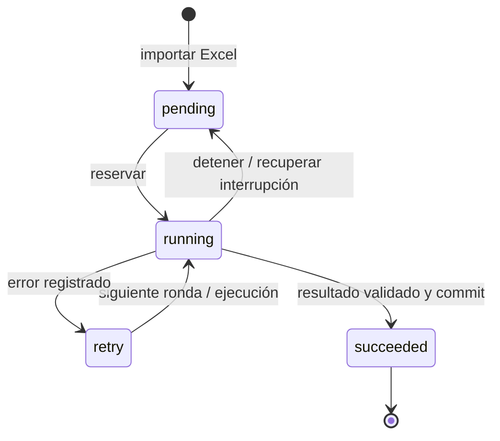

# Análisis y cambios — AstraCode

## Flujo encontrado

El punto de entrada es `src/main.py`; la GUI invocaba
`core/playwright_processor.py`. Los motores HTTP y Selenium y `src/processors.py`
son implementaciones anteriores, fuera del flujo activo. La documentación previa
describía partes de esas versiones.

El motor activo leía `Names_TicaPortal.xlsx` al abrir la ventana. Por consulta,
buscaba una URL completa en un DataFrame de 191 filas. La entrada de DUAs se leía
dos veces y se volvía a guardar como otro Excel. Después se cargaban filas de pandas
en una cola `asyncio.Queue` únicamente en memoria.

El flujo real observado es:

1. GET a `https://ticaconsultas.hacienda.go.cr/Tica/hcimppon.aspx`.
2. GeneXus construye el CAPTCHA en el navegador.
3. Se completan aduana, año, número y palabra; se pulsa **Detalle**.
4. El portal responde con `hcimdpola.aspx`; sus spans contienen los 38 campos.

No se necesitó un clic intermedio en la muestra de cuatro DUAs. La existencia de
otras variantes procede del requerimiento del usuario; su navegación específica
queda fuera de esta implementación. El marcador conocido `SALIR=OK` se clasifica
como `extra_step`; otras variantes pueden registrarse como timeout/extracción.

## Problemas y correcciones

| Hallazgo | Consecuencia anterior | Cambio |
| --- | --- | --- |
| Reanudar desde el mayor índice terminado | Podía saltar fallos anteriores y consultas en vuelo | Estado independiente por DUA en SQLite |
| Agregar al set global antes de escribir CSV | Un fallo de disco podía dejar un falso procesado | Resultado y éxito en una misma transacción |
| Set global de procesados compartido por lotes | Resultados de una hoja podían afectar otra | Identidad del lote por archivo y hoja |
| Validar solamente identificador no vacío | Se podía aceptar otro DUA o una identidad incompleta | Normalización y comparación exacta con el solicitado |
| Agotar reintentos, escribir TXT y avanzar índice | Fallidos podían desaparecer de la siguiente ejecución | Rondas completas, estado `retry` persistente |
| Cerrar GUI mientras había workers | Se perdía coordinación con trabajos en curso | Cancelación, devolución de reservas y espera antes de destruir Tk |
| Callback de fallido contado como progreso | Podía mostrarse 100% sin resultados completos | Porcentaje basado solo en `succeeded` |
| Dependencia del Excel de palabras y del host | Lectura innecesaria y catálogo frágil frente a cambio de dominio | JSON mínimo y diccionario inmutable por número de imagen |
| Lecturas/escrituras reiteradas de Excel | Trabajo innecesario en cada inicio | Importación transaccional y lectura local de SQLite |

## Persistencia y concurrencia

Un navegador Chromium sirve contextos aislados concurrentes. Un worker reserva
un DUA mediante una transacción `BEGIN IMMEDIATE`, incrementa el intento y lo marca
en curso. La extracción sucede fuera de la transacción. Después confirma el
resultado y el estado juntos, o registra el error y lo devuelve a reintento.

El bloqueo del lote impide que dos instancias recuperen simultáneamente las
reservas del mismo archivo SQLite. El sistema operativo libera ese bloqueo al
terminar el proceso, incluso sin cierre ordenado. La reserva SQL también es segura
con conexiones concurrentes. Se conserva sincronización `FULL` y journal local.
La elección usa las garantías de [transacciones de SQLite](https://www.sqlite.org/lang_transaction.html).

Cada ronda debe terminar antes de empezar la siguiente: un DUA difícil no consume
todos sus intentos mientras los últimos esperan su primera consulta. Los intentos
acumulados se conservan; el presupuesto de rondas se renueva al pulsar Iniciar.
Hay una espera creciente entre rondas y la detención cancela navegación en curso.
No hay un bucle de reintentos infinito que declare terminado un caso sin resultado.

Los estados válidos nunca desaparecen por cambiar el Excel: se conservan DUAs
anteriores. Las filas inválidas se auditan por revisión; corregirlas permite que
dejen de bloquear el porcentaje. Las filas duplicadas apuntan al mismo trabajo,
con referencias individuales a sus filas de origen.

## Pruebas realizadas

Se respetó el límite solicitado: **cuatro DUAs distintos consultados en TICA**.

| DUA | Resultado | Campos |
| --- | --- | --- |
| 001-2026-020591 | Identidad correcta, detalle obtenido | 38 |
| 001-2026-020592 | Identidad correcta, detalle obtenido | 38 |
| 001-2026-020594 | Identidad correcta, detalle obtenido | 38 |
| 001-2026-020607 | Motor nuevo: resultado confirmado en SQLite y exportado | 38 |

Las primeras tres consultas duraron 3,89; 3,14 y 2,72 segundos, respectivamente,
medidos sobre la navegación del diagnóstico. La cuarta ejecución completa duró
9,24 segundos, incluyendo arranque del navegador y persistencia. Estas mediciones
no son una comparación controlada de rendimiento entre motores.

El Excel local `data/Datos_Cargados/marzo26.xlsx` tiene 72.290 filas, sin duplicados
ni celdas vacías en `NroDUA`. Su prueba **local**, sin procesador ni consultas de red:

- Importación a SQLite: **5,703 s**.
- Reapertura usando la importación existente: **0,015 s**.
- Exportación del diagnóstico de pendientes: **3,000 s**.
- Estado final de esa prueba: **72.290 pendientes, cero intentos**.

Los reportes locales están bajo `logs/diagnostico_astracode/`, excluidos de Git.
Los tests automáticos verifican reservas concurrentes, reanudación fuera de orden,
crash de un subproceso, rollback de resultados, cancelación, fallos de exportación,
importación de CSV anteriores y progreso de Tk. La muestra real no demuestra que
todos los casos del portal funcionen: lo garantizado por el diseño es que un error
queda visible y recuperable, sin transformarse en un éxito ni saltarse por índice.

## Límites y operación

- No se implementó el clic extra, OCR ni descubrimiento de nuevas palabras CAPTCHA.
- El portal puede devolver errores o cambiar su HTML. Un DUA queda pendiente hasta
  obtener un resultado válido; no se fabrica un resultado para completar el 100%.
- Al agotar rondas, el lote queda con pendientes y puede retomarse con el mismo botón.
- HTML de error se conserva como evidencia local. No se publica en Git.
- El CSV se actualiza por intervalos y al finalizar; SQLite confirma cada resultado.
- Un disco dañado o la eliminación manual de la base requieren restaurar un respaldo.
- El spec incorpora el JSON. Se generó `DetallesBot_AstraCode.exe` y se comprobó
  su arranque con tema oscuro y una tabla ficticia sin el Excel original, con cero
  intentos de consulta. Los ejecutables de versiones anteriores no se sustituyeron.

La navegación usa la API oficial de [Playwright Page](https://playwright.dev/python/docs/api/class-page).
El motor HTTP anterior no se convirtió en el principal: el navegador ya ejecuta
correctamente el componente JavaScript de CAPTCHA en el flujo observado.
